# Especificación Técnica del Modelo de Base de Datos

**Proyecto:** HESPERIDES — Sistema de Catastro, Salud Vegetal y Gestión Operativa de Áreas Verdes  
**Institución:** Pontificia Universidad Católica del Perú (PUCP)  
**Facultad:** Ciencias e Ingeniería — Sección Ingeniería Informática / Software  
**Curso:** Proyecto de Fin de Carrera (DP2)  
**Estándar:** OMG UML 2.5.1 / Crow's Foot Entity-Relationship Model  
**Versión del Documento:** 2.0 (Actualización integral Post-Sprint 3)  
**Fecha:** 28 de octubre de 2026  
**Fuentes de Verdad:** [`specs/fundacionales/SPEC-002-modelo-datos.md`](../../../specs/fundacionales/SPEC-002-modelo-datos.md), [`specs/REGLAS.md`](../../../specs/REGLAS.md), [`specs/fundacionales/SPEC-003-catalogos-configurables.md`](../../../specs/fundacionales/SPEC-003-catalogos-configurables.md) y migraciones Flyway `V001`–`V023` en `backend/src/main/resources/db/migration/`.

---

## 1. Introducción y Alcance del Modelo de Datos

### 1.1 Contexto Institucional
La Sección de Áreas Verdes y Medio Ambiente de la Pontificia Universidad Católica del Perú (perteneciente a la Dirección de Administración y Finanzas — DAF / Oficina de Servicios Generales — OSG) gestiona un patrimonio vegetal compuesto por **15.6 hectáreas de cobertura verde** y aproximadamente **3 500 árboles y palmas** emplazados sobre un campus universitario de 41 hectáreas, coordinado por un equipo operativo de aproximadamente 30 colaboradores.

Históricamente, la información operativa y silvícola subsistía en hojas de cálculo heterogéneas dispersas en distintas unidades de almacenamiento en la nube, alimentando de forma manual e infrecuente un mapa interactivo desvinculado de la gestión de intervenciones. Esta desconexión impedía la auditoría de costos, el seguimiento del estado fitosanitario y la fiscalización de las frecuencias de mantenimiento comprometidas tanto por el personal propio como por contratistas tercerizados.

### 1.2 Propósito del Esquema de Base de Datos
El modelo de datos de Hesperides establece una **fuente única de verdad transaccional y espacial**, diseñada para resolver de forma integral:
1. La **georreferenciación precisa del catastro verde** mediante tipos geométricos nativos (`Point`, `Polygon`, `MultiPolygon`) sobre el elipsoide WGS 84.
2. La **programación, ejecución y validación técnica de intervenciones** agronómicas preventivas y correctivas (riego, desmoche, poda, fertilización, tratamientos fitosanitarios).
3. El **control de cumplimiento de frecuencias y contratos de servicios tercerizados**, fiscalizando las ejecuciones efectivas frente a los plazos pactados.
4. La **canalización, geolocalización y ciclo de vida de incidencias** fitosanitarias y de seguridad civil levantadas en campo.
5. La **trazabilidad inmutable de autoría y auditoría temporal**, preservando el historial completo de cambios sin incurrir en eliminación física de datos (*Soft Delete*).

---

## 2. Pila Tecnológica del Motor de Persistencia

| Componente | Tecnología Seleccionada | Justificación Técnica de Ingeniería |
| :--- | :--- | :--- |
| **Motor de Base de Datos** | **PostgreSQL 16** | Robustez relacional, soporte transaccional ACID estricto, índices parciales y tipos de datos semiestructurados (`JSONB`). |
| **Extensión Geoespacial** | **PostGIS 3.4** (`postgis/postgis:16-3.4`) | Motor espacial estándar OGC; soporte de tipos `GEOMETRY`, indexación espacial R-Tree mediante **GIST** y funciones de cálculo geodésico (`ST_DWithin`, `ST_Intersects`, `ST_Area`). |
| **Extensión Fonética/Texto** | `unaccent` | Normalización de búsquedas textuales insensibles a tildes y diacríticos (ej. «jardin» encuentra «jardín»). |
| **Sistema de Referencia (CRS)** | **EPSG:4326 (WGS 84)** | Estándar de coordenadas latitud/longitud adoptado por GeoJSON, OpenStreetMap y la cartografía web/móvil institucional. |
| **ORM / Acceso a Datos** | **Hibernate ORM + Hibernate Spatial (JTS 1.19)** | Mapeo objeto-relacional tipado hacia objetos de geometría `org.locationtech.jts.geom.{Point, Polygon, MultiPolygon}` con soporte de consultas espaciales nativas. |
| **Evolución del Esquema** | **Flyway Migration** (`spring-boot-starter-flyway`) | Control de versiones estricto, lineal, inmutable y auditable mediante scripts SQL numerados; política de ejecución `ddl-auto: validate` en producción y desarrollo. |
| **Pool de Conexiones** | **HikariCP** | Gestión de alto rendimiento con validación rápida de conexiones y configuración optimizada para entornos concurrentes. |

---

## 3. Arquitectura Modular del Modelo de Datos

El diseño del modelo de datos de Hesperides sigue un desacoplamiento estricto por dominios de responsabilidad, agrupados en **ocho (8) módulos persistentes** y **un (1) módulo transversal analítico**, fundamentados en `SPEC-002`:

```mermaid
flowchart TD
    classDef catalogo fill:#E1D5E7,stroke:#9673A6,stroke-width:2px,color:#3B1E54;
    classDef admin fill:#DAE8FC,stroke:#6C8EBF,stroke-width:2px,color:#0B2F64;
    classDef catastro fill:#D5E8D4,stroke:#82B366,stroke-width:2px,color:#1E4620;
    classDef auth fill:#F8CECC,stroke:#B85450,stroke-width:2px,color:#5C1D1D;
    classDef cuadrillas fill:#FFF2CC,stroke:#D6B656,stroke-width:2px,color:#5C4B08;
    classDef contratos fill:#FAD7AC,stroke:#B46504,stroke-width:2px,color:#4E2600;
    classDef intervenciones fill:#B1DDF0,stroke:#10739E,stroke-width:2px,color:#08384D;
    classDef incidencias fill:#FFE6CC,stroke:#D79B00,stroke-width:2px,color:#543800;
    classDef reportes fill:#D0ECE7,stroke:#1ABC9C,stroke-width:2px,color:#0E6251;

    subgraph ModuloCatalogos["📦 Catálogos (Transversal)"]
        CatalogType["CatalogType"]:::catalogo
        CatalogItem["CatalogItem"]:::catalogo
    end

    subgraph ModuloAuth["👥 Autenticación / Usuarios"]
        User["User"]:::auth
        RefreshToken["RefreshToken"]:::auth
    end

    subgraph ModuloAdmin["⚙️ Administración"]
        Zone["Zone"]:::admin
        Species["Species"]:::admin
        Supply["Supply"]:::admin
        SystemParameter["SystemParameter"]:::admin
        Place["Place"]:::admin
    end

    subgraph ModuloCuadrillas["👷 Cuadrillas"]
        Team["Team"]:::cuadrillas
        TeamMember["TeamMember"]:::cuadrillas
    end

    subgraph ModuloCatastro["🌳 Catastro (Núcleo Espacial)"]
        GreenElement["GreenElement"]:::catastro
        GreenElementAttachment["GreenElementAttachment"]:::catastro
        GreenElementAssessment["GreenElementAssessment"]:::catastro
    end

    subgraph ModuloContratos["📄 Contratos (Tercerización)"]
        Provider["Provider"]:::contratos
        Contract["Contract"]:::contratos
        ContractZone["ContractZone"]:::contratos
        ContractExecution["ContractExecution"]:::contratos
    end

    subgraph ModuloIntervenciones["🔧 Intervenciones"]
        Intervention["Intervention"]:::intervenciones
        InterventionElement["InterventionElement"]:::intervenciones
        InterventionSupply["InterventionSupply"]:::intervenciones
        InterventionEvidence["InterventionEvidence"]:::intervenciones
    end

    subgraph ModuloIncidencias["⚠️ Incidencias"]
        Incident["Incident"]:::incidencias
        IncidentStatusHistory["IncidentStatusHistory"]:::incidencias
        IncidentEvidence["IncidentEvidence"]:::incidencias
    end

    subgraph ModuloReportes["📊 Reportes (Analítico)"]
        Dashboard["Sin entidades propias\n(Consultas y vistas analíticas)"]:::reportes
    end

    %% Relaciones transversales de Catálogo
    ModuloCatalogos -.-> |"Tipos, estados y categorías"| ModuloAdmin
    ModuloCatalogos -.-> |"Roles institucionales"| ModuloAuth
    ModuloCatalogos -.-> |"Condición fitosanitaria"| ModuloCatastro
    ModuloCatalogos -.-> |"Tipo y estado de labor"| ModuloIntervenciones
    ModuloCatalogos -.-> |"Tipo y gravedad"| ModuloIncidencias
    ModuloCatalogos -.-> |"Frecuencia pactada"| ModuloContratos

    %% Autenticación / Usuarios hacia otros módulos
    User ==> |"Composición de miembros"| TeamMember
    User -.-> |"Autoría, asignación y validación"| Intervention
    User -.-> |"Reporta y atiende"| Incident
    User -.-> |"Fiscalización técnica"| ContractExecution

    %% Administración hacia Catastro, Cuadrillas y Contratos
    Zone ==> |"Contiene espacialmente"| GreenElement
    Species ==> |"Clasifica taxonómicamente"| GreenElement
    Zone -.-> |"Zona habitual"| Team
    Zone -.-> |"Zonas cubiertas"| ContractZone
    Supply ==> |"Insumos aplicados"| InterventionSupply

    %% Catastro hacia Intervenciones e Incidencias
    GreenElement ==> |"Historial de labores"| InterventionElement
    GreenElement ==> |"Incidencia asociada"| Incident
    GreenElement --- GreenElementAttachment

    %% Cuadrillas y Contratos hacia Intervenciones
    Team -.-> |"Ejecución por personal propio"| Intervention
    Contract ==> |"Intervención tercerizada"| Intervention
    ContractExecution -.-> |"Validación de visita"| Contract

    %% Intervenciones hacia Incidencias
    Incident -.-> |"Resolución técnica"| Intervention

    %% Reportes
    ModuloReportes -.-> |"Métricas consolidadas"| ModuloCatastro
    ModuloReportes -.-> |"Cumplimiento de frecuencias"| ModuloIntervenciones
    ModuloReportes -.-> |"Auditoría de incidentes"| ModuloIncidencias
```



### 3.1 Descripción de Módulos y Roles en la Arquitectura

1. **Módulo de Catálogos (`pe.edu.pucp.hesperides.modules.catalog` — SPEC-003):**
   Provee un motor de parametrización transversal de dos niveles jerárquicos (`CatalogType` y `CatalogItem` con autorreferencia `parent_item_id`). Evita el uso rígido de enumeraciones Java (`@Enumerated`), permitiendo extender tipologías de poda, estados de conservación, roles y categorías desde la base de datos sin obligar a nuevos despliegues de software.

2. **Módulo de Autenticación y Seguridad (`pe.edu.pucp.hesperides.modules.auth` — SPEC-001):**
   Gestiona las cuentas de usuario (`users`), credenciales hasheadas (`password_hash` mediante BCrypt con factor de costo 12), flags de rotación de credenciales (`must_change_password`) y sesiones de acceso mediante tokens de refresco criptográficamente seguros (`refresh_tokens`), permitiendo la revocación selectiva de sesiones activas.

3. **Módulo de Administración y Territorio (`pe.edu.pucp.hesperides.modules.admin` — SPEC-002 §4.3):**
   Administra el catálogo agronómico de especies (`species`), el catálogo de insumos fitosanitarios y fertilizantes (`supplies`), los parámetros configurables de la aplicación (`system_parameters`) y la zonificación territorial del campus (`zones`, `supervision_zones`, `places`). La zonificación maneja una jerarquía `Sector` (5) → `Sección` (519) → `Subsección`.

4. **Módulo de Cuadrillas (`pe.edu.pucp.hesperides.modules.admin.teams` — SPEC-100):**
   Modela los equipos operativos de campo (`teams`) y la membresía histórica de operarios (`team_members`). Registra el supervisor responsable, la zona habitual de trabajo y la trazabilidad temporal de ingresos y ceses en cada cuadrilla (`joined_at`, `left_at`).

5. **Módulo de Catastro Verde (`pe.edu.pucp.hesperides.modules.cadastre` — SPEC-002 §4.5, SPEC-103):**
   Constituye el núcleo geoespacial del sistema. Representa cada individuo arbóreo, palma o macizo mediante la entidad `GreenElement`, vinculado a coordenadas `Point(4326)` o polígonos `Polygon(4326)`. Almacena métricas dendrométricas (altura total, DAP, radio de copa), origen de la medición (`MEASURED`, `GENERIC`, `UNKNOWN`), historial de evaluaciones fitosanitarias periódicas (`green_element_assessments`) y repositorio de fotos de ficha técnica (`green_element_attachments`).

6. **Módulo de Contratos y Servicios Tercerizados (`pe.edu.pucp.hesperides.modules.contracts` — SPEC-002 §4.7):**
   Modela los contratos suscritos con proveedores externos (`providers`, `contracts`), las zonas del campus bajo cobertura pactada (`contract_zones`) y las visitas o ejecuciones realizadas por el contratista (`contract_executions`), permitiendo el cálculo de penalidades y liquidaciones por servicio.

7. **Módulo de Intervenciones Agronómicas (`pe.edu.pucp.hesperides.modules.interventions` — SPEC-002 §4.6):**
   Registra y orquesta las labores de mantenimiento silvícola. Soporta tanto el régimen de **personal estable PUCP** (`contract_id IS NULL`) como el de **servicios tercerizados** (`contract_id IS NOT NULL`). Posee una relación N:M con elementos del catastro (`intervention_elements`), consumo cuantitativo de insumos (`intervention_supplies`) y evidencias fotográficas obligatorias antes y después de la labor (`intervention_evidences`).

8. **Módulo de Incidencias Fitosanitarias y de Riesgo (`pe.edu.pucp.hesperides.modules.incidents` — SPEC-002 §4.8):**
   Permite el levantamiento de alertas de anomalías (plagas agresivas, inclinación de fuste con riesgo de desprendimiento, ramas secas sobre vías peatonales). Requiere obligatoriamente un punto GPS o un espécimen asociado (`chk_incidents_location`). Posee un historial auditable de transiciones de estado *append-only* (`incident_status_history`), fotografías de campo (`incident_evidences`) y resolución mediante enlace directo a una orden de intervención (`intervention_id`).

9. **Módulo de Reportes e Inteligencia Operativa (`pe.edu.pucp.hesperides.modules.reports` — SPEC-002 §2.1):**
   No introduce tablas de persistencia propias. Opera mediante vistas indexadas, funciones agregadas y consultas optimizadas para consolidar indicadores de cumplimiento de frecuencias (SPEC-101), tasas de atención de incidencias y consumo de insumos por sector.

---

## 4. Convenciones Arquitectónicas e Invariantes de Integridad

En estricta observancia de `REGLAS.md` (§5.4, INV-3, INV-4) y `SPEC-002` (§4.1), toda tabla del esquema cumple de manera obligatoria:

1. **Nomenclatura Estandarizada:** Nombres de tablas en plural minúscula en formato `snake_case` (ej. `green_elements`, `incident_status_history`). Columnas en `snake_case`.
2. **Clave Primaria Universal:** Toda tabla define `id BIGSERIAL PRIMARY KEY`.
3. **Auditoría Temporal Invariante:**
   ```sql
   created_at TIMESTAMP NOT NULL DEFAULT CURRENT_TIMESTAMP,
   updated_at TIMESTAMP NOT NULL DEFAULT CURRENT_TIMESTAMP,
   deleted_at TIMESTAMP NULL
   ```
4. **Política de Borrado Lógico (*Soft Delete*):**
   * Queda terminantemente prohibida la ejecución de sentencias SQL `DELETE` sobre tablas transaccionales de dominio.
   * `deleted_at IS NULL` denota vigencia activa. Una fila con fecha asignada se considera archivada.
   * En la capa JPA, toda entidad extiende la clase abstracta `@MappedSuperclass` `BaseEntity` y declara la anotación de exclusión global:
     ```java
     @SQLRestriction("deleted_at IS NULL")
     ```
5. **Índices de Unicidad Parciales:**
   * Toda restricción de unicidad de negocio convive con el borrado lógico mediante cláusulas `WHERE deleted_at IS NULL`. Esto permite la reactivación o reutilización de códigos operacionales liberados (ej. `idx_green_elements_code_active`).
6. **Desacoplamiento de Catálogos:**
   * Cualquier clave foránea que refiera a tipologías, clasificaciones o estados se nombra con el sufijo `_item_id` y apunta formalmente a `catalog_items(id)`.
7. **Integridad Referencial con Eliminación Restringida:**
   * Las claves foráneas aplican la regla implícita `ON DELETE RESTRICT`. No se implementan eliminaciones en cascada automáticas (`CASCADE`) a nivel relacional, salvaguardando la integridad histórica ante peticiones indebidas.
8. **Almacenamiento Desacoplado de Archivos Multimedia:**
   * La base de datos almacena exclusivamente metadatos (`storage_key`, `thumbnail_storage_key`, `content_type`, `size_bytes`), nunca binarios (`BYTEA`) ni URLs públicas temporales. Los archivos residen en almacenamiento de objetos (Amazon S3 / File System persistente), gobernados por el ciclo de purga automatizada de `V020`.

---

## 5. Diagrama Entidad-Relación Físico Integral (Crow's Foot)

El siguiente diagrama formal modela la estructura relacional completa del esquema Hesperides, integrando las tablas fundacionales (`V001`–`V014`) y las expansiones de registro catastral, lugares y gestión de medios (`V015`–`V023`).

```mermaid
erDiagram
    catalog_types ||--o{ catalog_items : "agrupa (1:N)"
    catalog_items |o--o{ catalog_items : "jerarquia_padre (0:N)"

    catalog_items ||--o{ users : "role_item_id"
    users ||--o{ refresh_tokens : "sesiones_activas"
    refresh_tokens |o--o| refresh_tokens : "replaced_by"

    users ||--o{ teams : "supervisa"
    zones |o--o{ teams : "zona_habitual"
    teams ||--o{ team_members : "integra"
    users ||--o{ team_members : "es_miembro"

    zones |o--o{ zones : "parent_zone"
    catalog_items ||--o{ zones : "zone_type_item_id"
    catalog_items ||--o{ zones : "use_type_item_id"
    users ||--o{ supervision_zones : "supervisada_por"

    places |o--o{ places : "parent_place"
    catalog_items ||--o{ places : "kind_item_id"
    catalog_items ||--o{ places : "category_item_id"
    zones |o--o{ places : "zona_asociada"
    places ||--o{ place_aliases : "alias_busqueda"

    catalog_items ||--o{ species : "species_type_item_id"
    catalog_items ||--o{ species : "origin_item_id"
    species ||--o{ species_common_names : "nombres_comunes"
    species ||--o{ species_photos : "galeria_fotos"

    species |o--o{ green_elements : "pertenece_a_especie"
    catalog_items ||--o{ green_elements : "element_type_item_id"
    catalog_items ||--o{ green_elements : "condition_item_id"
    zones |o--o{ green_elements : "ubicacion_administrativa"
    users ||--o{ green_elements : "registrado_por"
    import_batches |o--o{ green_elements : "lote_carga"

    green_elements ||--o{ green_element_attachments : "fotos_ficha"
    green_elements ||--o{ green_element_assessments : "evaluaciones_fitosanitarias"
    users ||--o{ green_element_assessments : "evaluado_por"

    catalog_items ||--o{ supplies : "unit_item_id"
    catalog_items ||--o{ supplies : "supply_type_item_id"

    zones ||--o{ interventions : "sector_intervenido"
    catalog_items ||--o{ interventions : "intervention_type_item_id"
    catalog_items ||--o{ interventions : "status_item_id"
    contracts |o--o{ interventions : "contrato_tercerizado"
    users ||--o{ interventions : "asignado_por"
    users ||--o{ interventions : "asignado_a"
    users |o--o{ interventions : "validado_por"

    interventions ||--o{ intervention_elements : "elementos_afectados"
    green_elements ||--o{ intervention_elements : "historial_trabajos"

    interventions ||--o{ intervention_supplies : "insumos_utilizados"
    supplies ||--o{ intervention_supplies : "insumo_aplicado"

    interventions ||--o{ intervention_evidences : "evidencias_fotograficas"
    catalog_items ||--o{ intervention_evidences : "moment_item_id"
    users ||--o{ intervention_evidences : "subido_por"

    providers ||--o{ contracts : "proveedor_adjudicado"
    catalog_items ||--o{ contracts : "service_type_item_id"
    catalog_items ||--o{ contracts : "status_item_id"
    users ||--o{ contracts : "fiscalizador_pucp"
    contracts ||--o{ contract_zones : "cobertura_espacial"
    zones ||--o{ contract_zones : "zona_adjudicada"
    contracts ||--o{ contract_executions : "visitas_realizadas"
    catalog_items ||--o{ contract_executions : "execution_status_item_id"
    users |o--o{ contract_executions : "verificado_por"

    catalog_items ||--o{ incidents : "incident_type_item_id"
    catalog_items ||--o{ incidents : "status_item_id"
    catalog_items ||--o{ incidents : "urgency_item_id"
    green_elements |o--o{ incidents : "arbol_afectado"
    zones |o--o{ incidents : "zona_incidencia"
    users ||--o{ incidents : "reportado_por"
    users |o--o{ incidents : "asignado_a"
    interventions |o--o| incidents : "resuelta_mediante"

    incidents ||--o{ incident_status_history : "trazabilidad_estados"
    catalog_items |o--o{ incident_status_history : "from_status_item_id"
    catalog_items ||--o{ incident_status_history : "to_status_item_id"
    users ||--o{ incident_status_history : "modificado_por"

    incidents ||--o{ incident_evidences : "evidencias_incidente"
    users ||--o{ incident_evidences : "adjuntado_por"

    catalog_types {
        bigint id PK
        varchar code UK
        varchar name
        boolean is_system
    }
    catalog_items {
        bigint id PK
        bigint catalog_type_id FK
        bigint parent_item_id FK
        varchar code
        varchar label
        int sort_order
        boolean is_active
        jsonb metadata
    }
    users {
        bigint id PK
        varchar email UK
        varchar password_hash
        bigint role_item_id FK
        boolean is_active
        varchar credential_status
        boolean must_change_password
    }
    refresh_tokens {
        bigint id PK
        bigint user_id FK
        varchar token_hash UK
        timestamp expires_at
        timestamp revoked_at
    }
    zones {
        bigint id PK
        varchar code UK
        varchar name
        bigint parent_zone_id FK
        bigint zone_type_item_id FK
        geometry boundary "MultiPolygon, 4326"
        numeric area_m2
        varchar map_code
    }
    places {
        bigint id PK
        varchar code UK
        varchar name
        bigint kind_item_id FK
        bigint category_item_id FK
        bigint zone_id FK
        geometry own_geometry "Geometry, 4326"
    }
    species {
        bigint id PK
        varchar scientific_name UK
        varchar slug UK
        varchar common_name
        bigint species_type_item_id FK
    }
    green_elements {
        bigint id PK
        varchar code UK "EV-XXXXXX"
        bigint species_id FK
        bigint element_type_item_id FK
        bigint condition_item_id FK
        geometry location "Point, 4326"
        geometry area "Polygon, 4326"
        numeric height_m
        numeric trunk_diameter_cm
        numeric crown_diameter_m
        varchar data_source "MEASURED | GENERIC | UNKNOWN"
    }
    green_element_assessments {
        bigint id PK
        bigint green_element_id FK
        date assessed_on
        bigint assessed_by_user_id FK
        boolean has_disease
        boolean has_pests
        boolean is_leaning
        varchar recommended_management
    }
    green_element_attachments {
        bigint id PK
        bigint green_element_id FK
        varchar storage_key
        varchar thumbnail_storage_key
        varchar content_type
        bigint size_bytes
    }
    supplies {
        bigint id PK
        varchar code UK
        varchar name
        bigint unit_item_id FK
        bigint supply_type_item_id FK
    }
    interventions {
        bigint id PK
        varchar code UK
        bigint zone_id FK
        bigint intervention_type_item_id FK
        bigint status_item_id FK
        bigint contract_id FK
        date scheduled_date
        timestamp started_at
        timestamp completed_at
        timestamp validated_at
        bigint assigned_by_user_id FK
        bigint assigned_to_user_id FK
        bigint validated_by_user_id FK
    }
    intervention_elements {
        bigint id PK
        bigint intervention_id FK
        bigint green_element_id FK
        text notes
    }
    intervention_supplies {
        bigint id PK
        bigint intervention_id FK
        bigint supply_id FK
        numeric quantity
    }
    intervention_evidences {
        bigint id PK
        bigint intervention_id FK
        bigint moment_item_id FK
        varchar storage_key
        timestamp captured_at
        geometry captured_location "Point, 4326"
    }
    providers {
        bigint id PK
        varchar tax_id UK
        varchar business_name
        varchar contact_email
        boolean is_active
    }
    contracts {
        bigint id PK
        varchar contract_number UK
        bigint provider_id FK
        bigint service_type_item_id FK
        bigint status_item_id FK
        date start_date
        date end_date
        numeric amount
        bigint responsible_user_id FK
    }
    contract_zones {
        bigint id PK
        bigint contract_id FK
        bigint zone_id FK
    }
    contract_executions {
        bigint id PK
        bigint contract_id FK
        date execution_date
        bigint status_item_id FK
        bigint verified_by_user_id FK
    }
    incidents {
        bigint id PK
        varchar code UK "INC-XXXX"
        varchar title
        text description
        bigint incident_type_item_id FK
        bigint status_item_id FK
        bigint urgency_item_id FK
        bigint green_element_id FK
        geometry location "Point, 4326"
        bigint reported_by_user_id FK
        bigint intervention_id FK
    }
    incident_status_history {
        bigint id PK
        bigint incident_id FK
        bigint from_status_item_id FK
        bigint to_status_item_id FK
        bigint changed_by_user_id FK
        text comment
    }
    incident_evidences {
        bigint id PK
        bigint incident_id FK
        varchar storage_key
        bigint size_bytes
        timestamp captured_at
    }
```



---

## 6. Diccionario de Datos Exhaustivo

### 6.1 Módulo Transversal de Catálogos (SPEC-003)

#### Tabla: `catalog_types`
Agrupa las tipologías configurables del sistema institucional.

| Columna | Tipo de Dato | Nulable | Restricciones | Descripción |
| :--- | :--- | :---: | :--- | :--- |
| `id` | `BIGSERIAL` | No | `PK` | Identificador único subrogado. |
| `code` | `VARCHAR(40)` | No | `UNIQUE` | Código técnico mnemónico (ej. `ROLE`, `INTERVENTION_TYPE`). |
| `name` | `VARCHAR(100)` | No | — | Nombre legible de la categoría. |
| `description` | `TEXT` | Sí | — | Descripción funcional del alcance de la clasificación. |
| `is_system` | `BOOLEAN` | No | `DEFAULT FALSE` | Indica si el catálogo gobierna lógica de código (impide borrado). |
| `created_at` / `updated_at` | `TIMESTAMP` | No | `DEFAULT NOW()` | Trazabilidad temporal de auditoría. |
| `deleted_at` | `TIMESTAMP` | Sí | — | Marca de borrado lógico. |

#### Tabla: `catalog_items`
Instancias concretas asociadas a cada tipo de catálogo. Permite jerarquía multinivel.

| Columna | Tipo de Dato | Nulable | Restricciones | Descripción |
| :--- | :--- | :---: | :--- | :--- |
| `id` | `BIGSERIAL` | No | `PK` | Identificador único del ítem. |
| `catalog_type_id` | `BIGINT` | No | `FK -> catalog_types(id)` | Tipo al que pertenece. |
| `parent_item_id` | `BIGINT` | Sí | `FK -> catalog_items(id)` | Autorreferencia jerárquica (ej. Clase de poda -> Tipo específico). |
| `code` | `VARCHAR(40)` | No | — | Código alfanumérico identificador dentro del tipo. |
| `label` | `VARCHAR(150)` | No | — | Etiqueta en lenguaje natural visible en el frontend. |
| `sort_order` | `INTEGER` | No | `DEFAULT 0` | Prioridad ordinal de visualización en formularios UI. |
| `is_active` | `BOOLEAN` | No | `DEFAULT TRUE` | Estado de disponibilidad para nuevas asignaciones. |
| `metadata` | `JSONB` | Sí | — | Estructura flexible para propiedades específicas del dominio. |

---

### 6.2 Módulo de Catastro e Inventario Verde (SPEC-002 §4.5, SPEC-103)

#### Tabla: `green_elements`
Núcleo del catastro silvícola del campus PUCP.

| Columna | Tipo de Dato | Nulable | Restricciones | Descripción |
| :--- | :--- | :---: | :--- | :--- |
| `id` | `BIGSERIAL` | No | `PK` | Identificador subrogado. |
| `code` | `VARCHAR(40)` | No | `UNIQUE (parcial)` | Código institucional único (ej. `EV-000045`). |
| `species_id` | `BIGINT` | Sí | `FK -> species(id)` | Taxón botánico asociado (nulable para césped sin especie única). |
| `zone_id` | `BIGINT` | Sí | `FK -> zones(id)` | Sección administrativa territorial asignada. |
| `element_type_item_id` | `BIGINT` | No | `FK -> catalog_items(id)` | Clasificación física (`Árbol`, `Palma`, `Arbusto`, `Césped`). |
| `condition_item_id` | `BIGINT` | Sí | `FK -> catalog_items(id)` | Condición física y de vitalidad (`Excelente`, `Bueno`, `Riesgo`). |
| `location` | `GEOMETRY(Point, 4326)` | Sí | `GIST Index` | Coordenadas geoespaciales puntuales del fuste/tallo. |
| `area` | `GEOMETRY(Polygon, 4326)` | Sí | `GIST Index` | Delimitación perimetral (cobertura superficial de copa o macizo). |
| `height_m` | `NUMERIC(5,2)` | Sí | `CHECK (>= 0)` | Altura total medida en metros desde el suelo a la cúspide. |
| `trunk_diameter_cm` | `NUMERIC(6,2)` | Sí | `CHECK (>= 0)` | Diámetro a la altura del pecho (DAP) en centímetros. |
| `crown_diameter_m` | `NUMERIC(5,2)` | Sí | `CHECK (>= 0)` | Diámetro promedio de la copa en metros. |
| `data_source` | `VARCHAR(20)` | No | `CHECK IN ('MEASURED', 'GENERIC', 'UNKNOWN')` | Fiabilidad y rigor metodológico de la métrica física. |
| `registered_by_user_id`| `BIGINT` | No | `FK -> users(id)` | Auditoría de autoría del empadronamiento inicial. |

*Restricción Invariante:* `CHECK (location IS NOT NULL OR area IS NOT NULL)` garantizando que ningún elemento carezca de representación espacial.

#### Tabla: `green_element_assessments`
Bitácora de inspecciones técnicas fitosanitarias periódicas.

| Columna | Tipo de Dato | Nulable | Restricciones | Descripción |
| :--- | :--- | :---: | :--- | :--- |
| `id` | `BIGSERIAL` | No | `PK` | Identificador de la evaluación. |
| `green_element_id` | `BIGINT` | No | `FK -> green_elements(id)` | Ejemplar inspeccionado. |
| `assessed_on` | `DATE` | No | — | Fecha cronológica de la evaluación técnica de campo. |
| `assessed_by_user_id` | `BIGINT` | Sí | `FK -> users(id)` | Inspector o cuadrilla a cargo de la prospección. |
| `has_disease` | `BOOLEAN` | Sí | — | Presencia de fitopatógenos (hongos, bacterias, virus). |
| `has_pests` | `BOOLEAN` | Sí | — | Presencia de insectos o plagas xilófagas/foliares. |
| `has_mechanical_damage`| `BOOLEAN` | Sí | — | Daño por impacto vehicular, cortacésped o vandalismo. |
| `is_leaning` | `BOOLEAN` | Sí | — | Inclinación anómala del fuste con compromiso radicular. |
| `has_dead_branches` | `BOOLEAN` | Sí | — | Presencia de ramas secas estructurales con riesgo de caída. |
| `has_cavities_or_rot` | `BOOLEAN` | Sí | — | Oquedades, pudrición basal o pudrición de madera activa. |
| `has_exposed_roots` | `BOOLEAN` | Sí | — | Raíces superficiales expuestas afectando pavimento o tránsito. |
| `interferes_with_infrastructure` | `BOOLEAN` | Sí | — | Conflicto con cableado aéreo, luminarias o edificaciones. |
| `recommended_management`| `VARCHAR(200)`| Sí | — | Prescripción técnica recomendada (poda, endoterapia, talado). |

---

### 6.3 Módulo de Intervenciones Agronómicas (SPEC-002 §4.6)

#### Tabla: `interventions`
Orden de trabajo operativo para cuadrillas propias o contratistas.

| Columna | Tipo de Dato | Nulable | Restricciones | Descripción |
| :--- | :--- | :---: | :--- | :--- |
| `id` | `BIGSERIAL` | No | `PK` | Identificador de la intervención. |
| `code` | `VARCHAR(40)` | No | `UNIQUE (parcial)` | Código operacional de trabajo (ej. `INT-2026-0034`). |
| `zone_id` | `BIGINT` | No | `FK -> zones(id)` | Zona del campus donde se ejecuta la actividad. |
| `intervention_type_item_id` | `BIGINT` | No | `FK -> catalog_items(id)` | Labor técnica (`Poda de altura`, `Riego`, `Fitosanitario`). |
| `status_item_id` | `BIGINT` | No | `FK -> catalog_items(id)` | Estado (`ASSIGNED`, `IN_PROGRESS`, `COMPLETED`, `VALIDATED`). |
| `contract_id` | `BIGINT` | Sí | `FK -> contracts(id)` | `NULL` = Cuadrilla interna PUCP; con valor = Tercerizado. |
| `scheduled_date` | `DATE` | No | — | Fecha programada para la ejecución en el calendario. |
| `started_at` | `TIMESTAMP` | Sí | — | Marca temporal del inicio de labores en campo. |
| `completed_at` | `TIMESTAMP` | Sí | — | Marca temporal de culminación por la cuadrilla. |
| `validated_at` | `TIMESTAMP` | Sí | — | Fecha de aprobación técnica por el supervisor. |
| `assigned_by_user_id` | `BIGINT` | No | `FK -> users(id)` | Coordinador que genera la orden de trabajo. |
| `assigned_to_user_id` | `BIGINT` | No | `FK -> users(id)` | Capataz o supervisor responsable de la cuadrilla. |
| `validated_by_user_id` | `BIGINT` | Sí | `FK -> users(id)` | Supervisor que certifica la conformidad técnica. |
| `description` | `TEXT` | Sí | — | Instrucciones de trabajo y alcance silvícola. |
| `execution_notes` | `TEXT` | Sí | — | Bitácora de incidencias reportada por el capataz. |

*Invariante Transaccional:* `CHECK ((validated_at IS NULL) = (validated_by_user_id IS NULL))` impidiendo validaciones anónimas o sin estampa de tiempo.

#### Tabla: `intervention_elements`
Tabla asociativa N:M que enlaza las órdenes de intervención con los elementos verdes.

| Columna | Tipo de Dato | Nulable | Restricciones | Descripción |
| :--- | :--- | :---: | :--- | :--- |
| `id` | `BIGSERIAL` | No | `PK` | Identificador asociativo. |
| `intervention_id` | `BIGINT` | No | `FK -> interventions(id)` | Intervención ejecutada. |
| `green_element_id` | `BIGINT` | No | `FK -> green_elements(id)` | Ejemplar individual o macizo intervenido. |
| `notes` | `TEXT` | Sí | — | Observaciones específicas sobre el espécimen particular. |

#### Tabla: `intervention_evidences`
Repositorio fotográfico de campo obligatorio para certificación.

| Columna | Tipo de Dato | Nulable | Restricciones | Descripción |
| :--- | :--- | :---: | :--- | :--- |
| `id` | `BIGSERIAL` | No | `PK` | Identificador de evidencia. |
| `intervention_id` | `BIGINT` | No | `FK -> interventions(id)` | Intervención vinculada. |
| `moment_item_id` | `BIGINT` | No | `FK -> catalog_items(id)` | Momento temporal (`BEFORE`, `AFTER`, `DURING`). |
| `storage_key` | `VARCHAR(500)` | No | — | Clave de objeto en el almacenamiento S3/disco. |
| `thumbnail_storage_key`| `VARCHAR(500)`| No | — | Clave de la miniatura optimizada a 400 píxeles. |
| `captured_at` | `TIMESTAMP` | Sí | — | Fecha y hora de captura registrada por el dispositivo móvil. |
| `captured_location` | `GEOMETRY(Point, 4326)` | Sí | — | Coordenadas GPS del operario al obturar la cámara. |
| `uploaded_by_user_id` | `BIGINT` | No | `FK -> users(id)` | Operario que transmitió la imagen al servidor. |

---

### 6.4 Módulo de Incidencias Fitosanitarias y de Riesgo (SPEC-002 §4.8)

#### Tabla: `incidents`
Alertas fitosanitarias o de seguridad civil levantadas en el campus.

| Columna | Tipo de Dato | Nulable | Restricciones | Descripción |
| :--- | :--- | :---: | :--- | :--- |
| `id` | `BIGSERIAL` | No | `PK` | Identificador de la incidencia. |
| `code` | `VARCHAR(40)` | No | `UNIQUE (parcial)` | Código correlativo (ej. `INC-2026-0102`). |
| `title` | `VARCHAR(200)` | No | — | Título descriptivo sintético de la anomalía. |
| `description` | `TEXT` | No | — | Detalle circunstanciado del hallazgo. |
| `incident_type_item_id`| `BIGINT` | No | `FK -> catalog_items(id)` | Tipo de incidencia (`Plaga`, `Ramas secas`, `Inclinación`). |
| `status_item_id` | `BIGINT` | No | `FK -> catalog_items(id)` | Estado actual (`REPORTED`, `IN_REVIEW`, `IN_PROGRESS`, `RESOLVED`). |
| `urgency_item_id` | `BIGINT` | No | `FK -> catalog_items(id)` | Nivel de severidad y prioridad de atención (`Baja`, `Alta`, `Crítica`). |
| `green_element_id` | `BIGINT` | Sí | `FK -> green_elements(id)` | Ejemplar individual asociado si fue identificado. |
| `zone_id` | `BIGINT` | Sí | `FK -> zones(id)` | Zona general donde se ubica el problema. |
| `location` | `GEOMETRY(Point, 4326)`| Sí | `GIST Index` | Ubicación geográfica exacta cuando no hay espécimen catalogado. |
| `reported_by_user_id` | `BIGINT` | No | `FK -> users(id)` | Usuario o inspector que detectó y cargó el incidente. |
| `intervention_id` | `BIGINT` | Sí | `FK -> interventions(id)` | Orden de trabajo asignada para solucionar el problema. |
| `reported_at` | `TIMESTAMP` | No | `DEFAULT NOW()` | Fecha y hora formal del registro de la incidencia. |
| `resolved_at` | `TIMESTAMP` | Sí | — | Momento en que la intervención vinculada fue validada. |

*Invariante de Ubicación:* `CHECK (green_element_id IS NOT NULL OR location IS NOT NULL)` asegurando que todo reporte sea físicamente localizable.

#### Tabla: `incident_status_history`
Bitácora de auditoría estricta *append-only* para el ciclo de vida de incidentes.

| Columna | Tipo de Dato | Nulable | Restricciones | Descripción |
| :--- | :--- | :---: | :--- | :--- |
| `id` | `BIGSERIAL` | No | `PK` | Identificador del evento histórico. |
| `incident_id` | `BIGINT` | No | `FK -> incidents(id)` | Incidencia que experimenta el cambio de estado. |
| `from_status_item_id` | `BIGINT` | Sí | `FK -> catalog_items(id)` | Estado origen (`NULL` en el evento de creación inicial). |
| `to_status_item_id` | `BIGINT` | No | `FK -> catalog_items(id)` | Nuevo estado asignado. |
| `changed_by_user_id` | `BIGINT` | No | `FK -> users(id)` | Autor del cambio de estado. |
| `comment` | `TEXT` | Sí | — | Justificación técnica de la transición o dictamen. |
| `created_at` | `TIMESTAMP` | No | `DEFAULT NOW()` | Estampa cronológica inmutable del cambio. |

---

### 6.5 Módulo de Contratos y Servicios Tercerizados (SPEC-002 §4.7)

#### Tabla: `contracts`
Contratos de prestación de servicios silvícolas celebrados con empresas externas.

| Columna | Tipo de Dato | Nulable | Restricciones | Descripción |
| :--- | :--- | :---: | :--- | :--- |
| `id` | `BIGSERIAL` | No | `PK` | Identificador del contrato. |
| `contract_number` | `VARCHAR(60)` | No | `UNIQUE (parcial)` | Número administrativo o expediente oficial del contrato. |
| `provider_id` | `BIGINT` | No | `FK -> providers(id)` | Razón social del proveedor adjudicatario. |
| `service_type_item_id` | `BIGINT` | No | `FK -> catalog_items(id)` | Tipo de servicio contratado (`Poda especializada`, `Riego cisterna`). |
| `status_item_id` | `BIGINT` | No | `FK -> catalog_items(id)` | Estado contractual (`Vigente`, `Suspendido`, `Concluido`). |
| `start_date` / `end_date`| `DATE` | No | `CHECK (end_date >= start_date)`| Período de vigencia formal del servicio. |
| `amount` | `NUMERIC(14,2)`| Sí | `CHECK (amount >= 0)` | Monto económico total convenido en el contrato. |
| `responsible_user_id` | `BIGINT` | No | `FK -> users(id)` | Fiscalizador interno de la PUCP a cargo del contrato. |

---

## 7. Estrategia de Indexación y Optimización de Consultas

El rendimiento del motor PostgreSQL 16 con PostGIS se garantiza mediante cuatro estrategias de indexación diseñadas para consultas concurrentes:

| Tipo de Índice | Estructura / Algoritmo | Propósito Arquitectural | Ejemplos de Implementación en Esquema |
| :--- | :--- | :--- | :--- |
| **Único Parcial** | B-Tree con predicado `WHERE deleted_at IS NULL` | Garantiza unicidad operativa en códigos y nombres vigentes, permitiendo la reactivación tras borrado lógico. | `idx_green_elements_code_active`, `idx_zones_code_active`, `idx_users_email_active` |
| **Geoespacial** | **GIST (Generalized Search Tree)** | Acelera drásticamente operaciones de proximidad (`ST_DWithin`), contención (`ST_Contains`) e intersección (`ST_Intersects`) a complejidad $O(\log N)$. | `idx_zones_boundary`, `idx_green_elements_location`, `idx_incidents_location` |
| **Claves Foráneas** | B-Tree convencional | Evita escaneos secuenciales (*Seq Scans*) en operaciones frecuentes de `JOIN` relacional y verificaciones de integridad referencial. | `idx_interventions_zone_id`, `idx_green_elements_species_id`, `idx_incidents_green_element` |
| **Compuesto de Estado** | B-Tree multicolumna | Optimiza los filtros predeterminados de las pantallas de gestión operativa en frontend. | `idx_interventions_status_date (status_item_id, scheduled_date)` |

---

## 8. Mapa Cronológico y Evolución de Migraciones Flyway

La evolución física del esquema se gestiona exclusivamente a través de migraciones Flyway inmutables bajo la directriz de **cronología lineal estricta y sin huecos** (`REGLAS.md §0.2`):

| Migración | Nombre del Archivo SQL | Dominio / Módulo | Descripción Funcional y Alcance Estructural |
| :--- | :--- | :--- | :--- |
| **V001** | `V001__baseline_schema.sql` | `auth`, `catalog` | Esquema base: extensión `unaccent`, tablas `catalog_types`, `catalog_items`, `users`, `refresh_tokens`, `teams`, `team_members` y roles institucionales. |
| **V002** | `V002__create_maintenance_frequencies.sql` | `admin` | Reglas de frecuencia estacional de mantenimiento (`maintenance_frequencies`, `maintenance_frequency_seasons`). |
| **V003** | `V003__create_system_parameters.sql` | `admin` | Tabla de configuración de parámetros de sistema fuertemente tipados (`system_parameters`). |
| **V004** | `V004__enable_postgis.sql` | `infrastructure` | Habilitación de la extensión espacial: `CREATE EXTENSION IF NOT EXISTS postgis;`. |
| **V005** | `V005__create_zones.sql` | `admin` | Zonas jerárquicas del campus (`zones`) con límites `MultiPolygon` WGS 84; añade FK `teams.zone_id`. |
| **V006** | `V006__create_supervision_zones.sql` | `admin` | Zonas territoriales de asignación de supervisores de campo (`supervision_zones`). |
| **V007** | `V007__create_place_references.sql` | `admin` | Puntos de referencia con nombre coloquial y alias de búsqueda (`place_references`, `place_reference_aliases`). |
| **V008** | `V008__create_campus_buildings.sql` | `map` | Polígonos de huella edilicia (`campus_buildings`) y niveles de extrusión para renderizado 3D. |
| **V009** | `V009__create_campus_features.sql` | `map` | Mobiliario urbano del campus (tachos, bancas, bebederos) en `campus_features`. |
| **V010** | `V010__create_map_data_version.sql` | `map` | Versión incremental atómica de capas vectoriales para invalidación de caché en el visor 3D web. |
| **V011** | `V011__seed_map_data.sql` | `map` | Datos semilla oficiales de los 5 sectores territoriales, secciones, edificios y mobiliario del campus. |
| **V012** | `V012__create_species.sql` | `cadastre` | Catálogo taxonómico botánico (`species`, `species_common_names`) con `slug` indexado para URLs web. |
| **V013** | `V013__create_green_elements.sql` | `cadastre` | Tabla principal de elementos verdes (`green_elements`) con metrología dendrométrica y PostGIS. |
| **V014** | `V014__seed_green_inventory.sql` | `cadastre` | Carga inicial oficial de 90 especies y 966 ejemplares botánicos georreferenciados en el campus. |
| **V015** | `V015__create_catastro_registration.sql` | `cadastre` | Lotes de importación CSV (`import_batches`), bitácora fitosanitaria (`green_element_assessments`) y adjuntos (`green_element_attachments`). |
| **V016** | `V016__seed_measurements_2026_and_fountains.sql`| `cadastre` | Incorporación de mediciones dendrométricas de campo 2026 y bebederos de agua. |
| **V017** | `V017__allow_many_species_photos.sql` | `cadastre` | Habilita galerías de fotos múltiples por especie botánica (`species_photos`). |
| **V018** | `V018__create_places.sql` | `admin` | Modelo jerárquico de lugares de interés (`places`, `place_aliases`) y geometrías vinculadas. |
| **V019** | `V019__create_place_reference_links.sql` | `admin` | Enlaces bidireccionales de convergencia entre referencias históricas y nuevos lugares. |
| **V020** | `V020__track_purged_photo_files.sql` | `infrastructure` | Control de depuración física programada de archivos huérfanos tras 4 meses de borrado lógico. |
| **V021** | `V021__add_place_map_view.sql` | `map` | Vistas cartográficas optimizadas para el visor web de lugares y áreas verdes. |
| **V022** | `V022__add_perspective_map_view.sql` | `map` | Vistas de perspectivas fotográficas georreferenciadas desde el exterior e interior de edificios. |
| **V023** | `V023__add_perspective_sort_order.sql` | `map` | Campo de ordenamiento ordinal para carruseles de perspectivas fotográficas de lugares. |

---

## 9. Seguridad, Control Transaccional y Respaldos

1. **Gestión Criptográfica de Credenciales:**
   * Las contraseñas de usuario se almacenan exclusivamente bajo hash BCrypt con sal aleatoria (`password_hash`), jamás en texto plano.
   * Los tokens de sesión revocables se almacenan mediante su resumen criptográfico SHA-256 (`token_hash`), impidiendo la suplantación de identidad en caso de volcados accidentales.
2. **Atomicidad e Integridad Transaccional (ACID):**
   * Toda operación de modificación de estado que afecte múltiples entidades (ej. registro de intervención + deducción de insumos + actualización de incidencia) se ejecuta bajo el nivel de aislamiento `READ_COMMITTED` gestionado por Spring Boot `@Transactional`.
3. **Mecanismo de Respaldo y Restauración Operacional:**
   ```bash
   # Respaldo completo en caliente con compresión binaria
   docker exec -t hesperides-db pg_dump -U hesperides -F c -b -v -f /tmp/hesperides_backup.dump hesperides

   # Restauración íntegra de estructura y datos espaciales
   docker exec -i hesperides-db pg_restore -U hesperides -d hesperides -v /tmp/hesperides_backup.dump
   ```
